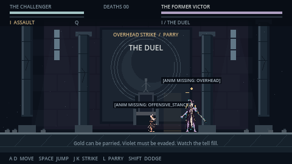

# Gitgud: Cycle — v0.2

A playable, keyboard-first 2D Soulslike boss duel made in **Godot 4.6 / GDScript**. One ceremonial hall, one former victor, three continuous phases. Your only progression is learning the fight.



Version 0.2 adds a sharp 46-pixel dash, supplied sprite animations, contextual boss branches, and stronger impacts. See [the changelog](docs/V02_CHANGELOG.md) and [animation inventory](docs/ANIMATION_STATUS.md).

New to the code? Start with the [codebase and tuning cheatsheet](docs/CODEBASE_CHEATSHEET.md): exact locations and examples for HP, damage, movement, boss difficulty, and sprites.

## Play

1. Install the standard **Godot 4.6.x** editor; .NET is not required.
2. Import this folder's `project.godot` in the Godot project manager.
3. Press **F6** with `scenes/main.tscn` open, or **F5** to run the project.
4. Press **Enter** to start. **Tab** skips the introduction.

Alternatively, from this folder: `godot --path .`

The game renders at **480×270**, scales in whole pixels, keeps a 16:9 aspect ratio, and opens at 1440×810. Resize to another integer multiple for clean pixels. Physics runs at 60 Hz; rendering is capped at 60 FPS. The Compatibility renderer targets modest integrated GPUs. No downloads, plugins, paid assets, credentials, or runtime services are needed.

### Controls

| Key | Action |
| --- | --- |
| A / D | Move and face left / right |
| Space | Jump; release early for a shorter jump |
| J / K | Light / heavy attack |
| L | Parry toward your facing direction |
| Shift | Short dodge in the held direction, or your facing direction |
| Q | Switch Assault / Guard stance |
| R | Immediate retry after death or a completed ending |
| Esc | Pause / resume |
| Enter | Start; also skips the introduction |
| Tab | Skip introduction |
| M | Mute / unmute synthesized sound effects |
| F3 | Toggle missing-animation labels in development builds |

See [CONTROLS.md](CONTROLS.md) for timing and combat rules.

## Learn the duel

- **Assault** offers faster attacks, full damage, and a five-frame parry window. **Guard** moves and attacks more slowly, deals 85% damage, and offers roughly ten parry frames.
- **Gold tells can be parried. Violet cross tells cannot.** The small line above the boss fills during anticipation; a full line means the attack is arriving. The subtle floor marker shows its reach.
- Parry the sword, jump the low chain sweep, and dodge through the returning chain. Defensive late parries catch a small guard window but cost health and posture. There is no indefinite block.
- Each swing can hit a fighter once. Attack direction locks when anticipation begins. Attacks require commitment; the final 160 ms of recovery can buffer your next strike.
- Build the boss's posture with strikes and parries. A break staggers him for two seconds and makes incoming damage 50% stronger. Player posture breaks also leave an extended opening.
- The boss pauses briefly at 70% and 35% health. Transitions are invulnerable, clear pending attacks, and introduce longer patterns with slightly faster timing. Death restarts directly into combat.

| Attack | Startup / active / recovery, phase 1 seconds | Response |
| --- | --- | --- |
| Horizontal slash | 0.60 / 0.13 / 0.55 | Parry or retreat |
| Overhead strike | 0.84 / 0.15 / 0.85 | Parry or dodge through; punish recovery |
| Forward thrust | 0.49 / 0.17 / 0.63 | Parry or jump the narrow hitbox |
| Chain sweep | 0.90 / 0.24 / 0.60 | Jump or dodge; cannot parry |
| Delayed heavy | 1.18 / 0.15 / 0.90 | Wait for the completed tell; parry or dodge |
| Chain recall | 0.65 / 0.19 / 0.76 | Dodge through or get out of reach; cannot parry |

## Project map and tuning

- `scenes/main.tscn`: ready-to-run entry scene; the world is assembled from built-in nodes.
- `scripts/game.gd`: title, skippable intro, fight, death/retry, ending, pause, particles and hit-stop.
- `scripts/player.gd`: movement and action state machine; exported movement, parry, dodge and recovery parameters; attack specifications in `begin_attack`.
- `scripts/boss.gd`: explicit idle/approach/reposition/startup/active/recovery/stagger/transition/dead states; six attack dictionaries; contextual selection, bounded optional combo branches, phase aggression and thresholds.
- `scripts/fighter.gd`: shared health, posture, physical body and feedback signals.
- `scripts/hitbox.gd`: actual `Area2D` sword collisions, opponent-only masks, and per-swing hit deduplication.
- `scripts/character_visual.gd`: `AnimatedSprite2D` presentation, gameplay-synchronized attack segments, same-character fallback poses, afterimages and missing-state labels.
- `scripts/animation_library.gd`: cached sheet loading, alpha/key handling, integer scale, frame layout and fallback resolution; data in `assets/characters/animations.json`.
- `scripts/arena.gd`: masonry, throne, mural, parallax, phase visuals, motes, chain and attack tells.
- `scripts/hud.gd`: bars, stance, death count, tells, dialogue and overlays.
- `scripts/sound.gd`: short synthesized PCM effects with no external assets.
- `scripts/controls.gd`: installs InputMap defaults only for missing actions. Add matching actions in Project Settings → Input Map to override them.

Collision layers: 1 = world, 2 = Challenger, 3 = boss (bitmasks 1, 2, 4). Fighter bodies collide with the floor; weapons monitor the opponent's body. Fighters can pass through one another, allowing cross-through dodges. Attack sizes, reach, and height are in native-resolution pixels. Anticipation sets the hitbox early so the physics broadphase is ready before active frames.

## Validation

Run the complete suite from the project folder:

```sh
python3 tools/check.py
```

On Windows use `python tools/check.py`; set `GODOT` to the Godot console executable if it is not on PATH. The runner imports resources, detects script errors even when Godot returns zero, then runs:

- 17 combat checks: movement, jump, real hitboxes, damage, parry, dodge, guard, posture, phase thresholds and patterns.
- 19 loop checks: complete intro, controls, pause, natural AI death, retry, all six attacks, victory, transformation and skip.
- 9 timing checks: jump buffering, coyote time, attack buffering, facing, player posture break, unparryable attacks, hit-stop and retry cleanup.
- 10 movement checks: exact dash travel, instant speed, locked direction, stopping, buffers and commitment.
- 19 animation checks: all sheets, alpha, alignment, flipping, playback, timing and fallbacks.
- 13 AI checks: contextual selection, optional branches, commitment, recovery and cancellation.
- 7 feedback checks: cue differentiation, directional sparks, impact strength and recoil.
- 3 real-time audio checks: synthesized buffers, playback start, and playback completion.
- One complete input-driven duel: normal controls defeat the boss through every phase and encounter all six attack types. No health, damage, phase or invulnerability cheats are used. Presentation hit-stop is disabled only in this deterministic run and tested separately.

**Executed successfully on Linux using Godot 4.6.3.** Graphical runs used the real Compatibility renderer under Xvfb/Mesa; v0.2 captures are in `docs/screenshots/v02/`. All 97 assertions and one input-driven duel pass. This is automated execution and visual inspection, not a human balance playtest. Windows native execution and hardware performance have not been measured.

For a fresh graphical capture with a display available:

```sh
godot --path . --rendering-method gl_compatibility --script tests/capture.gd
```

Captures go to Godot's `user://captures/`, or to the directory specified by `GITGUD_CAPTURE_DIR`. This script requires a rendering display; headless mode cannot validate pixels.

## Windows export

The project runs directly in the Windows editor. A `Windows Desktop` export preset is included for a self-contained x86-64 executable. Install matching export templates through **Editor → Manage Export Templates**, then use **Project → Export → Windows Desktop**. Create `builds/windows/` if needed. A native Windows executable is not included or tested here.

## Scope and known limitations

- All 12 supplied character sheets are integrated. Dedicated player attacks and five boss attacks are still missing; existing sprite poses and explicit development labels cover them. See the animation inventory for every fallback.
- Six attacks, contextual combo branches and all three phases work; timing, damage, readability and difficulty still need human playtesting. The perfect-timing automated player is a reachability check, not evidence of suitable difficulty.
- The fight has synthesized effects but no music, voice acting, controller support, keybinding menu, save system or accessibility settings. Death count is retained through retries during the current session only.
- No exploration, inventory, leveling or additional enemies are planned for this MVP.
- The arena is a single screen with minor background parallax. There are no scrolling rooms or elaborate environmental animations.
